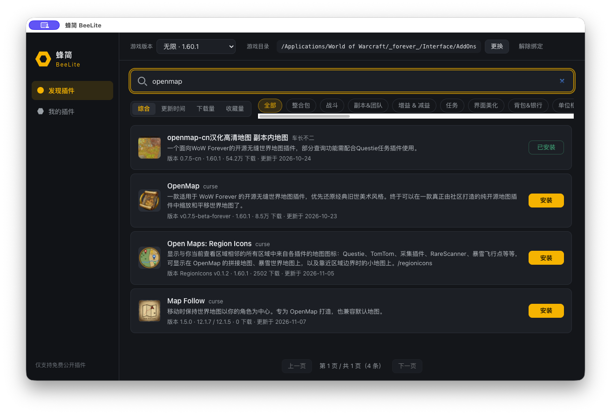
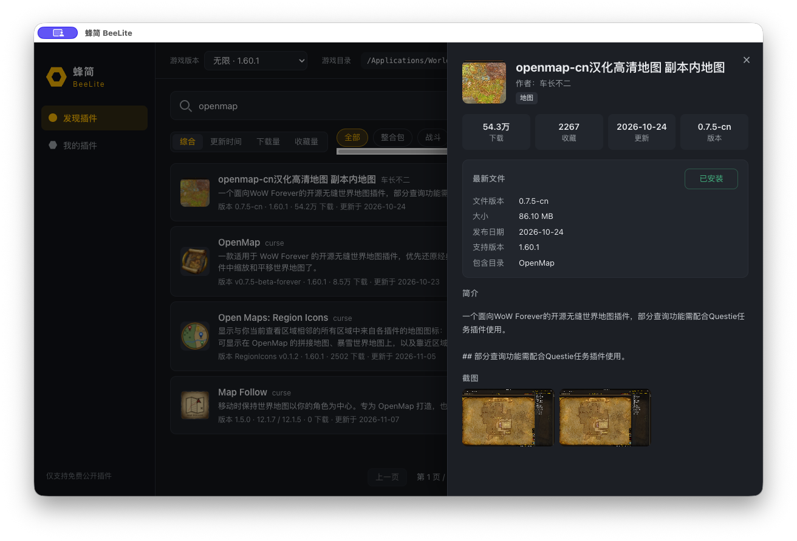
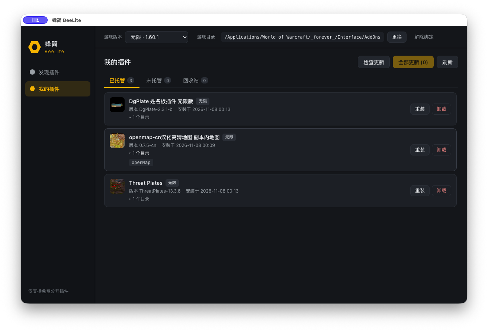

# 蜂简 BeeLite

> A minimal World of Warcraft addon manager for macOS — search, install, manage. Nothing else.

蜂简是一款面向 macOS（Apple Silicon）的魔兽世界插件管理工具，只做三件事：**搜索插件、一键安装、管理已安装插件**。没有账号、广告、社区、云同步、付费会员、游戏启动或 AI 功能。

| 项目 | 说明 |
| --- | --- |
| 当前版本 | 0.1.5 |
| 支持平台 | macOS，Apple Silicon（arm64） |
| 技术栈 | Electron 45 · TypeScript · Node.js 24 |
| 签名状态 | ad-hoc 本地签名；无 Apple 开发者证书签名，未经公证 |
| 许可证 | 暂未授予开源许可证（见[许可证](#许可证)） |

## 目录

- [界面预览](#界面预览)
- [功能](#功能)
- [安装与启动](#安装与启动)
- [从旧版本升级](#从旧版本升级)
- [使用指南](#使用指南)
- [游戏版本支持](#游戏版本支持)
- [数据源说明](#数据源说明)
- [本地数据与文件保护](#本地数据与文件保护)
- [从源码构建](#从源码构建)
- [测试与验证范围](#测试与验证范围)
- [已知限制](#已知限制)
- [许可证](#许可证)

## 界面预览

以下截图摄于 2026-11-08，来自打包后的应用，游戏版本为「无限」。插件名称、下载量、版本等数据来自上游接口，会随时间变化。



**发现插件**：按关键词搜索，可切换排序和分类；每条结果显示版本、支持的游戏版本、下载量和更新日期，以及“已安装”或“安装”按钮。

<details>
<summary>插件详情与我的插件</summary>



**插件详情**：显示当前游戏版本对应的最新文件，包括文件版本、大小、发布日期、支持的游戏版本和包含的插件目录。



**我的插件**：分为已托管、未托管、回收站三个标签；已托管插件可以展开查看所包含的目录，也可以重装或卸载。

</details>

## 功能

- **发现插件**：关键词搜索、分类筛选、四种排序（综合 / 更新时间 / 下载量 / 收藏量）、分页浏览。详情中可以看到简介、截图、当前版本文件、文件大小、包含的插件目录和支持的游戏版本。
- **一键安装**：按当前选择的游戏版本获取对应的最新正式文件，界面显示下载、校验、安装的进度，下载阶段可以取消。
- **插件管理**：检查更新、单个更新、全部更新、重装、卸载；卸载的插件进入回收站，可以恢复。
- **插件更新提醒**：蜂简运行期间自动检查所有已绑定游戏目录中由蜂简安装的插件（打开后一次，之后每小时一次），发现更新时在侧栏和顶部提示；只提醒，由你确认后点击更新。
- **识别已有插件**：扫描 AddOns 中原有的插件目录，读取 TOC 中的名称、版本和 Interface 信息。
- **多版本**：每个游戏版本单独绑定游戏目录，切换版本时搜索结果和本地列表互不混用；插件操作的目标是发起操作时所选的版本及其绑定的目录。
- **客户端更新**：自动检查蜂简新版本，并展示新版本的更新说明；点一次「下载并更新」即可完成下载、校验、安装并重新启动。

## 安装与启动

1. 在 [Releases](https://github.com/NginxL/beelite/releases) 页面下载 `BeeLite-0.1.5-arm64-mac.zip`。
2. 解压后，把 `BeeLite.app` 拖入「应用程序」（Applications）文件夹。
3. 从「应用程序」文件夹双击打开。

建议放在「应用程序」文件夹中运行。客户端更新要求应用位于可以被替换的位置：如果直接在「下载」文件夹里运行（macOS 可能把它放在只读的临时位置），或者从磁盘映像等只读位置运行，更新会被拒绝并提示先移动应用。放在其他可写位置时，更新也能进行。客户端更新只在打包后的 Apple 芯片版本中提供。

> [!IMPORTANT]
> 本应用只有 ad-hoc 本地签名，没有 Apple 开发者证书签名，也没有经过公证。首次打开时，macOS 可能会阻止运行或提示无法验证开发者。请根据你对来源的信任自行决定是否运行；本项目不提供绕过系统安全机制的方法。

## 从旧版本升级

- **0.1.3 / 0.1.4**：发现新版本时会弹出这个版本的更新说明，点「下载并更新」即可（见[更新蜂简本身](#4-更新蜂简本身)）。
- **0.1.1 / 0.1.2**：可以在应用内更新。侧栏发现新版本后，点「下载并更新」即可；也可以按下面的步骤手动覆盖安装。这两个版本发现新版本时不会弹出更新说明，这是 0.1.3 新增的功能：升级到 0.1.3 或更新的版本之后，再有新版本时才会显示说明。
- **0.1.0**：没有客户端更新功能，需要按下面的步骤手动覆盖安装一次。可以直接安装最新版本，不需要先安装 0.1.1。之后的版本都可以在应用内更新。

1. 从 [Releases](https://github.com/NginxL/beelite/releases) 下载 `BeeLite-0.1.5-arm64-mac.zip` 并解压。
2. 退出正在运行的蜂简。
3. 把新的 `BeeLite.app` 拖入「应用程序」文件夹，选择替换旧版本。
4. 重新打开蜂简。

替换 `BeeLite.app` 会保留你的数据：游戏目录绑定（`settings.json`）、已安装插件、回收站（`Interface/.beelite`）以及游戏设置（`WTF`），升级不需要也不应该删除它们。新版本首次启动时，和平常启动一样，会先检查并恢复上次留下的未完成插件操作（如果有）。

## 使用指南

### 1. 选择游戏版本与目录

1. 在顶部的「游戏版本」中选择版本，默认是「无限」。
2. 点「选择目录」，选中该版本的目录，例如：
   - 无限：`/Applications/World of Warcraft/_forever_`
   - 正式服：`/Applications/World of Warcraft/_retail_`

   直接选其中的 `Interface` 或 `Interface/AddOns` 也可以，蜂简会自动换算到版本目录。
3. 在确认对话框中核对最终的插件目录后，点「绑定」。

绑定规则：

| 情况 | 结果 |
| --- | --- |
| 同一个目录已经绑定给另一个游戏版本 | 拒绝 |
| `_forever_` 选给正式服，或 `_retail_` 选给无限 | 拒绝 |
| 目录名不是常见名称（自定义目录） | 显示提示，确认后才绑定 |
| 目录中还没有 `Interface` 或 `WTF` 文件夹 | 显示提示，确认后才绑定；第一次安装时会创建 `Interface/AddOns` |

没有绑定目录也可以浏览插件库。第一次点「安装」时，会先要求选择并确认目录。

### 2. 安装插件

在「发现插件」中搜索，点「安装」，或打开详情后点「安装」。以下情况会在安装前提示或拒绝：

- 插件包含的目录已经属于另一个由蜂简安装的插件：**拒绝安装**，以免互相覆盖；
- 插件包含的目录在 AddOns 中已存在，但不是蜂简安装的：**需要你确认**，确认后原目录移入回收站，由新插件接管；
- 服务器上没有当前游戏版本的文件，或文件声明的游戏版本与当前版本不符：**拒绝安装**，不会拿其他版本的文件代替；
- 插件不是免费公开内容：**不提供安装**。

### 3. 管理插件

「我的插件」分为三个标签：

| 标签 | 包含的内容 | 可以做的操作 |
| --- | --- | --- |
| 已托管 | 由蜂简安装的插件。蜂简记录了它的插件编号、文件编号、游戏版本和全部目录 | 检查更新、更新、全部更新、重装、卸载 |
| 未托管 | AddOns 中已有、但不是由蜂简安装的目录 | 查看 TOC 信息、移入回收站 |
| 回收站 | 卸载的插件、更新前的备份、安装时接管的目录 | 恢复、永久删除 |

说明：

- **未托管的目录不会被自动更新**，蜂简也不会按目录名去猜它对应哪个远端插件。如果想让蜂简管理它，可以直接安装对应的插件；安装时会提示接管，原目录进入回收站。
- **更新进度显示在插件所在的行**：点「全部更新」后，要更新的插件依次显示等待中、下载百分比、校验中、安装中；每更新完一个，这一行立即显示刚安装的版本，可更新数量同时减少。失败或取消的插件保留原来的版本并在行内说明原因，其余插件继续更新；结束时汇总已更新、取消和失败的数量。全部更新进行中，原「更新」按钮的位置显示不可点击的状态（检查中、等待中、下载百分比等），「重装」「卸载」以及发现页、详情中的对应按钮暂时不能点击，结束后恢复。单独更新或重装时也在这一行显示进度。（0.1.3 及更早版本在全部更新期间不会逐个显示，已完成的插件要等全部结束后才显示新版本。）
- **重新载入窗口后继续显示进行中的操作**：插件操作的状态保存在蜂简的主进程中，窗口重新载入（菜单「窗口 → 重新载入」）后，进行中的全部更新、每个插件的状态和下载进度、任务卡片及其「取消」按钮会恢复，取消作用于原来的那次下载。窗口读取到这些状态之前，托管插件的安装、更新、重装、卸载和全部更新暂时不可用（未托管目录和回收站的操作不受影响）；读取失败时所有页面顶部显示原因和「重试」按钮。重新载入之后才结束的全部更新或卸载，结束后会自动重新读取完整列表（包括回收站），即使结束时列表还在读取中。某个插件正在下载并占用游戏目录时，「我的插件」列表要等这一项完成或取消后才能读出，在此之前可以在任务卡片中查看进度或取消。后台有插件操作进行中时不会自动弹出蜂简新版本的更新说明，结束后再显示。（0.1.4 及更早版本重新载入后不显示进行中的全部更新。）
- **同一目录的写操作不会互相冲突**：全部更新进行中，同一游戏目录的更新、重装和卸载会被拒绝，全部更新还在检查时也不能安装新插件（开始逐个更新后可以安装不在计划中的新插件）；有插件正在单独安装、更新或卸载时，不能开始全部更新；同一个插件同时只能有一个操作。这些限制由主进程判断，不依赖界面按钮的状态，只作用于同一个游戏目录。
- **更新和重装前核对安装记录**：蜂简在写入游戏目录前，核对插件仍是你点击时看到的那次安装（文件编号和安装时间）。等待期间它被卸载、重新安装或更新时，这一项不执行，也不会被当作新安装；全部更新的汇总中单独列出“排队期间已变化未处理”。从回收站恢复的是原来那条记录，恢复后核对仍然通过。重装可以重新安装同一版本，也能补回被手动删除的插件目录。
- 每个插件只保留最近一次的更新前备份。
- 恢复时，如果任何目标目录已经存在，或者已经属于其他插件，会提示冲突，并且不做任何改动。
- 操作目标以发起操作时页面上显示的游戏版本和目录为准：
  - 卸载、移入回收站、永久删除、解除绑定等需要确认的操作：如果在确认期间切换了游戏版本，或该版本改绑了其他目录，操作会被取消，不做任何改动。
  - 已经开始的单个安装、更新或重装：固定在最初的目录完成，不会转向新绑定的目录。
  - 全部更新：每项开始前都会核对绑定；换绑后，正在处理的一项仍在原目录完成，剩余的插件不再处理。
- **检查结果按目录区分**：检查更新的结果属于检查时的游戏版本和目录。同一版本更换目录、刷新、安装、更新、卸载或恢复之后，旧的结论不会套用到其他目录或已变化的插件上；需要时重新检查即可（0.1.2 及更早版本在直接更换目录后可能沿用旧目录的结果）。
- **按其他游戏版本安装的插件**：一个目录改绑给另一个游戏版本后（例如纠正选错的版本），其中原先按旧版本安装的插件会带黄色版本标签显示。它们可以卸载，卸载后也可以从回收站恢复（恢复后仍记录原来的版本）；但蜂简不会为它们检查更新，也不会更新或重装，以免用当前版本的文件替换。「全部更新」会跳过它们并在结果中列出。如需改用当前版本，请先卸载，再从「发现插件」安装。

#### 自动检查插件更新

蜂简运行期间会自动检查所有已绑定游戏目录中由蜂简安装（已托管）的插件，不只是当前显示的版本。每个目录只检查按它当前绑定的游戏版本安装的托管插件；按其他游戏版本安装的托管插件显示“不检查更新”，未托管的目录不检查。

| 项目 | 行为 |
| --- | --- |
| 检查时机 | 打开蜂简、完成启动恢复后检查一次，之后每个目录每小时一次。电脑从睡眠中唤醒时，只补查已经到检查时间的目录，而且最多补一次，不会补发睡眠期间错过的多次。退出蜂简后不再检查，蜂简没有后台服务 |
| 暂缓的情况 | 有插件正在安装、更新、卸载、恢复，正在读取「我的插件」，或客户端更新已下载完成、正在等待安装时，自动检查推迟约 30 秒再试；客户端正在下载更新时检查照常进行。蜂简退出时停止检查，进行中的检查立即中止 |
| 发现更新时 | 侧栏「我的插件」显示所有游戏版本的可更新总数；顶部提示条列出有更新的游戏版本，点击直接前往该版本的「我的插件」；游戏版本下拉框中也会标出数量。运行中新发现的更新还会出现一次提示消息，同一个插件的同一个新文件只提示一次 |
| 安装 | 不会自动安装。需要你点「更新」或「全部更新」；安装时会重新核对插件是否免费、最新文件和兼容性 |
| 检查失败时 | 失败的插件不会显示为“已是最新”；网络暂时不可用、连接中断、超时或服务器繁忙时，按 5、15、60 分钟重试，期间仍显示上次已发现的更新并标注本次失败；其他错误（例如服务器没有该版本的文件、目录无法访问）按正常的每小时检查，不会更频繁。设置文件无法读取时无法确认任何目录的绑定：所有目录之前的结论（包括“已是最新”和已发现的更新）都不再显示，各页面顶部显示“插件更新检查已暂停”，自动检查暂停一小时后再读取设置；修复或恢复设置文件后，先在「我的插件」点「刷新」或「重试」恢复插件列表（已有列表时是「刷新」，首次加载失败时是「重试」，都只重新读取列表），再点「检查更新」恢复检查：这次检查成功后会解除暂停并重新检查所有目录；只点「刷新」或「重试」不会恢复检查，要等一小时后自动重读设置 |
| 状态 | 「我的插件」标题旁显示该目录上次检查的时间与失败数量 |

自动检查只读取设置和各目录的插件清单、查询插件的最新文件信息，不会写入设置、游戏目录或 `Interface/.beelite`。检查结果只保存在内存中，重新打开蜂简后会重新检查。更换或解除绑定、安装、更新、卸载、恢复之后，相关的旧结论和提醒立即失效；检查期间如果目录或插件发生了变化，这次的结果不会显示，蜂简会重新检查。

插件作者发布新版本后，要先被 NewBeeBox 收录为该游戏版本的最新文件，蜂简才能发现，因此提醒可能晚于作者发布。是否有更新按 NewBeeBox 的文件编号判断。

### 4. 更新蜂简本身

侧栏底部显示当前版本。蜂简在启动后和之后每天检查一次新版本，也可以点「检查更新」或使用菜单「蜂简 → 检查客户端更新…」。检查只确认有没有新版本，不会下载。

发现新版本后，蜂简会弹出这个版本的更新说明，显示当前版本、新版本和说明内容（纯文本），可以选择「稍后」或「下载并更新」：

- 同一个版本在一次启动中只自动弹出一次：说明一显示就记为已提醒，即使在说明打开时重新载入界面也不会再弹出；点「稍后」不会下载，也不会跳过这个版本，之后可以随时点侧栏的「更新说明」再次查看。
- 有确认框打开、或插件操作正在进行时，说明会等它们结束后再弹出，不会打断正在进行的确认；这时从侧栏手动打开说明也会提示先完成当前操作。
- 新版本没有提供说明时，会明确显示“此版本未提供更新说明”。

点「下载并更新」（在说明中或侧栏中）后，蜂简会依次下载、校验签名、解压，然后安装并自动重新启动，不需要再次确认。如果在你点击之后服务器上的新版本又变了，蜂简不会下载那个没看过说明的版本，而是显示它的说明，等你再次点击。更新只替换蜂简应用本身，不会改动游戏目录、插件和设置。

- **等待与取消**：如果有插件正在安装、更新、卸载或恢复，会显示「等待插件操作完成…」，等这些操作结束后再安装，期间不能开始新的插件操作。下载过程中和等待插件操作时可以取消，校验和解压阶段不提供取消。
- **安装过程**：蜂简窗口会先关闭，替换完成后自动重新打开。替换有时需要较长时间（测试中出现过数分钟），期间可能显示 Sparkle 的安装进度，请等待它完成，不要手动打开蜂简。如果应用所在文件夹需要管理员权限才能修改，macOS 会弹出系统授权框。
- **失败时**：在开始替换之前取消，或者下载、校验失败，当前版本保持不变，稍等片刻即可重试。替换过程中出错时，Sparkle 会尝试把旧版本放回原处，但不能保证成功；万一应用无法打开，请从 Releases 重新下载安装（数据不受影响）。

## 游戏版本支持

应用内预设了下表中 7 个游戏版本的映射；各版本的显示名称、游戏版本号和插件分类从插件库的远端配置读取。远端配置中新增的游戏版本不会被自动支持；远端配置获取失败时，仍显示预设版本，本地管理照常可用；但安装和更新需要用配置中的版本号核对文件，这时无法进行。各版本的验证程度不同：

| 游戏版本 | 目录名提示 | 实网验证 |
| --- | --- | --- |
| 无限（WoW Forever） | `_forever_` | 搜索、详情、下载、安装、更新检查、卸载、恢复 |
| 正式服 | `_retail_` | 搜索；以及确认服务器没有对应文件时会拒绝安装 |
| 泰坦重铸、熊猫人之谜、燃烧的远征、经典旧世、探索赛季 | 无（只做一般性提示） | 未单独验证 |

所有版本都**没有在游戏客户端内验证过插件能否实际加载**。

## 数据源说明

插件目录和下载文件来自 NewBeeBox 客户端使用的公开匿名接口（`api.newbeebox.com`、`cdn2.newbeebox.com`、`cdn8.newbeebox.com`）。

- 本项目与 NewBeeBox、暴雪娱乐均无关联，也未获得它们的认可或背书。这些接口不是官方提供的、有稳定协议的第三方 API，随时可能变化或不可用。
- 接口不可用时：搜索、详情、安装、检查更新、更新和重装都无法使用；本地扫描、卸载和回收站恢复仍可使用。
- 请求不携带 NewBeeBox 账号凭据、Cookie 或设备标识（如 boxid），使用标明 BeeLite 的 User-Agent。
- 只安装明确免费、可公开访问的插件；安装前会再次核对。不支持任何付费或会员功能。
- 插件数据的网络访问只限上述三个域名，只允许 HTTPS；重定向的每一跳都会重新检查域名。
- 蜂简运行期间每小时为每个已绑定目录中的每个已托管插件查询一次最新文件（同时最多 3 个请求，目录依次进行），见[自动检查插件更新](#自动检查插件更新)。

客户端更新是另一条独立的通道：只从本仓库的 GitHub Releases 获取更新信息（`appcast.xml`）和安装包，由 [Sparkle](https://sparkle-project.org) 2.9.6 完成下载、签名校验和安装。更新信息与安装包都带有项目专用的 EdDSA 签名，应用只接受与内置公钥匹配的签名；签名不符、更新信息被篡改或下载不完整时都会拒绝更新，并保留当前版本。更新说明是写在已签名的 `appcast.xml` 中的纯文本，蜂简不会下载任何外部说明页面，也不会把说明当作网页渲染。客户端更新不依赖 NewBeeBox 接口。

BeeLite 是独立实现。开发前曾对 NewBeeBox 的发布包做过有限的静态分析，用来理解插件与目录的对应关系和更新流程。本仓库不包含原程序的任何代码。

## 本地数据与文件保护

### 数据位置

| 位置 | 内容 | 何时写入 |
| --- | --- | --- |
| `<版本目录>/Interface/AddOns/` | 插件目录 | 安装、更新、卸载、恢复时；回滚未完成的事务时 |
| `<版本目录>/Interface/.beelite/` | 已托管插件清单（`manifest.json`）、事务日志、下载暂存区（`staging/`）、回收站（`trash/`） | 第一次执行写操作时创建；之后在写操作、事务恢复和暂存/回收清理时更新。与 AddOns 位于同一磁盘卷，游戏不会加载其中的内容 |
| Electron 的 `userData` 目录（`app.getPath('userData')`） | 各游戏版本的目录绑定（`settings.json`）；Electron/Chromium 自身的缓存等运行数据 | `settings.json` 在绑定或解除绑定目录时写入；运行数据由 Electron/Chromium 在应用运行期间写入 |
| `~/Library/Caches/app.beelite.addons/org.sparkle-project.Sparkle/` 与 `app.beelite.addons` 偏好域 | Sparkle 下载的更新包与少量更新状态 | 检查和下载客户端更新时 |

游戏目录中，蜂简只在 `Interface/` 下写入。`WTF/`（包括 SavedVariables）既不读取内容也不修改；选择目录时只检查这个文件夹是否存在，作为判断是否为游戏目录的参考。首次接入、目录中还没有蜂简元数据时，只读扫描不会在游戏目录中创建任何文件；已有蜂简元数据的目录，在启动、绑定或扫描时，可能会自动恢复未完成的事务，并清理暂存数据和已登记删除的回收项。

`settings.json` 不存在时视为首次使用。如果它存在但无法读取（例如没有读取权限），或者内容不是有效的蜂简设置，蜂简会在「我的插件」中显示错误和文件路径，并暂停读取和修改目录绑定，不会覆盖、改名或删除这个文件；这时启动时也不会自动恢复各目录的未完成操作。修复该文件或从备份恢复后，点击「重试」即可继续使用。

### 安装与失败处理

| 环节 | 做法 |
| --- | --- |
| 下载 | 先写入暂存区，再校验文件长度；服务器提供 MD5 时一并校验 |
| 压缩包检查 | 拒绝路径穿越、绝对路径、符号链接、加密条目、内容不同的重复条目和大小写冲突；检查插件目录结构；限制压缩包大小（1 GiB）、解压总量（4 GiB）和条目数（100,000）。不按压缩比拒绝，以兼容高度重复的贴图等合法内容 |
| 解压 | 每个文件的实际输出不得超过声明大小；逐个文件校验 CRC32 和写入后的实际大小。解压中的数据错误（例如无效的压缩编码、实际大小与声明不符）会中止安装并清理暂存区 |
| 替换 | 在同一磁盘卷内按事务日志移动目录：旧版本的全部目录（包括新版已删除的目录）移入备份，新目录移入 AddOns，最后原子提交清单 |
| 中途失败 | 按目录身份逆序回滚，恢复到安装前的状态 |
| 进程中断 | 下次启动或下次操作时，根据事务日志完成恢复 |
| 无法自动判定 | 例如原位置被其他程序占用：保留事务日志、备份和现场，暂停该目录的所有写操作，并在界面中显示相关路径，等待人工处理 |

其他行为：

- 蜂简不执行插件中的任何文件（包括 Lua），只读取 TOC 元数据。
- 如果 `Interface`、`AddOns` 或蜂简的数据目录是符号链接，蜂简拒绝写入。
- 上述大小限制是资源上限，不是磁盘配额；解压前不检查剩余磁盘空间，空间不足时安装会失败并清理暂存区。
- 以上措施用于降低误操作和异常带来的风险，但不能替代你自己的备份。

## 从源码构建

需要 Git、Node.js 24 与 npm。

```sh
git clone https://github.com/NginxL/beelite.git
cd beelite
npm ci
npm start             # 编译并启动应用
npm run typecheck     # 类型检查（主进程、界面、测试）
npm test              # 单元与集成测试，只使用系统临时目录
npm run smoke         # 实网冒烟测试，见下文
npm run dist          # 打包 arm64 .app 与 zip，输出到 release/，并校验产物
```

打包需要 Xcode（或 Command Line Tools）来编译客户端更新的原生模块。`npm run native` 会从 Sparkle 官方 GitHub Release 下载固定版本 2.9.6 并按 SHA256 校验，然后针对 Electron 头文件编译 arm64、最低 macOS 13.0 的原生模块；`npm run dist` 会自动执行这一步。维护者的签名与发布流程见 [docs/RELEASING.md](docs/RELEASING.md)。

`npm run smoke` 会访问真实接口，下载三个免费插件（RegionIcons 约 216 KB、Questie 约 2.2 MB、Plater 约 5.6 MB），在临时的模拟游戏目录中依次完成安装、扫描、重装、卸载和恢复：

- 临时目录建在 `SMOKE_PARENT` 下（默认是项目内的 `.smoke/`），每次运行新建一个专用子目录；
- 运行结束后只删除这个子目录；
- 设置 `SMOKE_KEEP=1` 可以保留现场。

### 项目结构

```text
src/
  core/       插件源、ZIP 校验、TOC 解析、目录布局、事务与插件管理（不依赖 Electron）
  main/       Electron 主进程、本地页面协议、IPC 参数校验
  preload/    沙箱 preload，向界面暴露的接口
  renderer/   中文界面
  shared/     主进程与界面共用的类型
native/       客户端更新原生模块（Objective-C++，Node-API，调用官方 Sparkle 公开接口）
test/         单元与集成测试（Node 内置 test runner）
scripts/      构建、原生模块、发布签名、E2E 测试包、图标生成、实网冒烟测试
build/        应用图标
```

### 开发用环境变量

以下变量只用于开发和测试，正常使用时不需要设置：

| 变量 | 作用 |
| --- | --- |
| `BEELITE_USER_DATA_DIR` | 使用独立的 `userData` 目录，与日常使用的设置隔离 |
| `BEELITE_TEST_BIND` | 启动时预先绑定测试目录，格式如 `9=/tmp/test/_forever_`，多个版本用 `;` 分隔。只有同时设置了 `BEELITE_USER_DATA_DIR` 才生效，并且拒绝 `/Applications/World of Warcraft` 下的目录 |
| `BEELITE_DEVTOOLS=1` | 允许在打包版本中打开开发者工具 |

## 测试与验证范围

### 0.1.5

0.1.5 修复三个问题：全部更新进行中重新载入窗口后，界面丢失进行中的状态，此时卸载还没轮到的插件，旧批次之后会把它重新安装回来；切换目录后同名的未托管目录显示另一个目录的“处理中”；全部更新还在检查时，其他插件的安装让待更新的插件提前显示“全部更新中”。插件的安装事务与回滚、全部更新的换绑停止规则、写入闸门、客户端更新和自动检查的只读约束都没有改变。

改动内容：

| 方面 | 行为 |
| --- | --- |
| 主进程的操作状态 | 主进程记录进行中的全部更新（检查中 / 逐项处理）、每个任务的阶段与下载进度、已受理的单个插件写操作；界面先订阅推送、再读取状态快照，按同一序列的版本号丢弃过时的一方，任务事件与快照之间也按这个版本号比较，旧快照不会让进度倒退、清除新的操作或让已结束的任务重新显示为进行中 |
| 冲突防护 | 全部更新与同一目录的更新、重装、卸载双向互斥；同一插件同时只受理一个操作；在确定目标目录之后、开始远端请求和等待目录锁之前占用，每次操作在自己结束时释放；批次自身逐项更新不受这项限制；其他目录照常操作 |
| 安装记录核对 | 更新与重装在目录锁内、读到当前清单之后、下载之前核对插件仍托管、游戏版本相同，且文件编号与安装时间与受理时一致；首次安装要求插件尚未托管。不满足时不下载、不写入 |

**自动化测试：203 项全部通过**（0.1.4 的 179 项全部保留，新增 24 项）。原有测试按新的接口调整了参数（更新请求带上安装记录、界面测试先读取操作状态），断言的含义不变。新增测试同样使用测试数据、临时目录和可控的模拟数据源与下载，不访问真实接口：

| 方面 | 覆盖内容 |
| --- | --- |
| 重新载入 | 丢弃旧界面的订阅，旧页面发出的请求在销毁后不再把结果交回旧页面（旧页面的后续刷新不会替新页面完成），把编译后的界面复制到新位置重新载入全部模块，按启动顺序订阅后读取状态，主进程服务与其中进行中的操作保持不变：批次第一项停在取得目录锁之前的远端请求时，新界面显示批次与排队中的插件，界面入口不发请求，直接经 preload 调用卸载、更新、重装、全部更新都被主进程拒绝且清单不变，批次结束后自动重新读取列表并恢复可操作，模拟的 WTF 不变；计划确定之前重新载入显示“检查中”；下载停在 35% 时重新载入，只凭状态快照立即恢复同一任务的卡片与进度，不重复、不重新下载，取消按钮取消原任务 |
| 冲突防护 | 单项更新停在远端请求、卸载正在等待目录锁时，同一目录的全部更新被拒绝；同一插件的重复操作被拒绝；其他目录的操作不受影响，它的结束也不解除这个目录的批次；失败收尾后不留占用；旧批次的释放不影响之后的批次 |
| 安装记录核对 | 受理后插件被卸载、换了文件或同一文件被重新安装时，更新与重装都不下载、不写入、不会复活；另一插件的提交不影响本插件的核对；从回收站恢复原记录后核对通过（已知边界）；重装同一文件会重新下载提交，插件目录缺失时重装补回；绕过防护卸载计划中的后项时，旧批次跳过它并单独计数，之后换绑停止时剩余数正确 |
| 状态时序 | 开始前读出的空快照晚到不清除占用；进行中读出的快照在结束之后到达不复活任务；读取失败时页面顶部显示原因与重试，发现页按钮显示“暂不可用”，托管插件的写入口保持禁止，重试后恢复，失败晚于更新的推送时不覆盖 |
| 结束后的完整列表 | 重新载入后首次列表读取已读出旧状态、回复晚于批次结束或单项卸载结束时，回复到达后自动补读一次，界面的托管记录、未托管目录与回收站与主进程的完整列表一致，不循环读取；回复到达前切换到另一个目标时，旧回复被丢弃，另一个目标不受影响，切回时读到结束后的列表 |
| 客户端更新说明 | 本界面没有本地占用、但主进程有进行中的批次、下载任务或卸载时，不自动弹出说明、不回执，手动打开也等待；结束后才弹出，只发送已读回执，不更新；首次同步状态尚未完成时推迟自动说明，获取失败时不因此无限推迟；侧栏“下载并更新”仍按原流程授权 |
| 两个显示问题 | A、B 目录中同名的未托管目录各自显示自己的占用；批次检查阶段另一目录的单项安装不改变待更新插件的“检查中”，计划确定后才显示等待中 |

**其他验证**

| 项目 | 结果 |
| --- | --- |
| 主进程独立场景（编译后的 IPC、preload 与插件管理，模拟数据源与临时 ZIP，只写入临时的模拟游戏目录） | 10 个场景共 159 项检查通过：等待目录锁期间插件被卸载或安装记录变化时，更新与重装（含 force）不下载、不写入、不复活；同版本重装与补回缺失目录各重新下载一次；首次安装遇到已托管的插件不改动；批次中途变化与换绑的计数正确；客户端更新冻结写入时四个写入口都被拒绝；正在等待目录锁的卸载阻止之后的全部更新。每个场景结束后没有残留的占用、暂存或事务日志，模拟的 WTF 不变 |
| 界面独立场景（编译后的界面模块，真实主进程服务与 preload，模拟的 DOM、IPC 传输与下载） | 重新载入后批次占用恢复，界面与直接调用都无法卸载排队中的插件、也无法发起第二个批次，结束后卸载正常且不会被装回；下载停在 35% 时重新载入，只凭状态快照恢复同一任务的卡片，取消作用于原任务，重试只新建一个任务并成功；列表回复晚于批次结束时自动补读一次，完整列表与主进程一致；延迟到达的旧快照不复活已结束的任务；同名未托管目录、批次“检查中”提示、首次读取失败的提示与重试、更新说明的弹出时机均符合上文 |
| 打包产物与发布文件 | 生产打包校验与代码签名校验通过（ad-hoc 签名，未使用 Developer ID，未经公证）；ZIP 与 appcast 的签名由此前版本内置的同一生产公钥验证通过；ZIP 内容与校验过的应用一致，安装包内的编译文件与测试所用的编译结果一致，版本为 0.1.5，feed 中的更新说明与 `release-notes/0.1.5.txt` 一致；原生更新模块、Sparkle 与安全相关的构建配置与 0.1.4 相同 |

**未验证的部分**：重新载入是在测试中模拟的，没有通过真实 Electron 菜单操作；界面场景使用模拟的 DOM、IPC 传输和网络，不等于打包后应用的界面验收。这个版本没有实际进行 0.1.4 → 0.1.5 的应用内更新安装，也没有验证插件在游戏客户端内的加载，没有在 macOS 13 设备上测试。

### 0.1.4

0.1.4 修复全部更新期间的显示问题：已经更新完成的插件仍显示旧版本，可更新插件的「更新」按钮仍可点击并会排入额外操作。现在每个插件的进度和结果显示在它自己的行上，批次期间同一目录中已安装插件的更新、重装和卸载暂停。插件的安装事务、回滚、全部更新的停止规则、写入闸门和自动检查的只读约束都没有改变。

**自动化测试：179 项全部通过**（0.1.3 的 169 项全部保留，新增 10 项）。全部使用测试数据、临时目录和可控的模拟下载，不访问真实接口，也不访问 Keychain。新增测试经过编译后的界面、真实 preload（主进程事件按发送顺序送达界面）和真实主进程服务，写入临时的模拟游戏目录：

| 方面 | 覆盖内容 |
| --- | --- |
| 逐项显示 | 第一项已提交、第二项停在下载 35% 时：第一行立即显示清单中刚提交的版本，不再显示“可更新”，全局可更新数减一，期间没有发起整页刷新；第二行显示真实进度，未开始的项目显示等待中；原「更新」按钮的位置本身变为禁用的“检查中 / 等待中 / 下载中 35%”，下载百分比变化时按钮与行的节点不变、只更新文字；每个任务恰好一个完成事件并带有提交记录；批次中行顺序不变；结束后全部恢复可操作 |
| 防止重复操作 | 从发起全部更新开始（包括批次重新检查、计划尚未确定时），对当前游戏版本与目录中已托管的插件，直接调用更新、重装、卸载、安装、全部更新以及点击行内和发现页按钮，都不发出请求、不查询远端、不新增下载、不弹出确认框；单项更新进行中同样如此，其他插件不受影响。安装尚未托管的其他插件不受批次限制 |
| 失败、取消与停止 | 一项失败、一项在任务面板中取消后继续处理下一项；失败与取消的插件保留旧版本并在行内说明，汇总分别计数，取消不计为失败；批次中途换绑时，正在处理的一项只写入原目录，未开始的项目不再处理、结束等待且不新建任务卡片，另一目录中同名插件不显示这次的进度、版本或禁用状态，也没有被写入 |
| 时序与身份 | 提交之前读出的本地状态回复晚到时，不会把已显示的新版本改回旧版本：列表已显示时旧回复被丢弃；切换到其他版本再切回、列表尚未就绪时，回复会叠加已提交的记录（不为此重新读取，其他版本的完成不影响当前列表，记录也不会套用到改绑后的目录）；事件只按游戏版本、目录与插件编号关联，其他目录或其他版本的事件、旧任务或重复的完成事件不影响当前行；“已是最新”没有提交时不带安装记录，不改动安装时间与目录；提交成功后读回清单失败时仍算安装成功，并明确显示无法确认更新状态 |

**其他验证**

| 项目 | 结果 |
| --- | --- |
| 临时目录场景（真实主进程服务、preload、插件 ZIP 解压与事务、编译后的界面状态；用本地 ZIP 代替下载，不访问网络） | 成功、部分失败、取消后继续、同一版本中途换绑四个场景共 85 项检查通过：已提交的项目在磁盘和界面上同时显示新版本，失败与取消的项目保持旧版本且汇总分别计数，换绑后只写入原目录、新目录不变；等待与进行中的行写入按钮均禁用，批次结束后没有残留的等待状态；模拟的 WTF 不变 |
| 界面预览（Chromium 加载编译后的界面，使用内存中的模拟接口，窗口 1100×760 与最小 1000×660） | 发起后按钮显示“检查中”；当前项显示下载百分比，下一项显示等待中；第一项完成后立即显示新版本、可更新数为 1，第二项仍在 35%；取消或失败的项目保留旧版本，批次结束后可以重试，取消后重试成功；全部成功后各行恢复操作、可更新数为 0；没有界面脚本错误 |
| 界面状态独立复核（直接运行编译后的界面模块，使用模拟接口） | 15 项检查通过，覆盖列表尚未就绪时的提交、按钮原位状态、进度更新不重建节点，以及按目录、游戏版本与任务区分的事件；编译产物与按当前源码重新编译的结果逐字节一致 |
| 打包产物与发布文件 | 生产打包校验与代码签名校验通过（ad-hoc 签名，未使用 Developer ID，未经公证）；ZIP 与 appcast 使用原有签名密钥签名，并由此前版本内置的生产公钥验证通过；安装包内的编译文件与源码构建一致，版本为 0.1.4，feed 中的更新说明与 `release-notes/0.1.4.txt` 一致 |

**未验证的部分**：界面预览在 Chromium 中使用模拟接口，不等于打包后 Electron 应用的界面验收；临时目录场景不涉及真实插件下载。这个版本没有实际进行 0.1.3 → 0.1.4 的应用内更新安装，也没有验证插件在游戏客户端内的加载。客户端更新的原生部分与 0.1.3 相同，下文 0.1.3 及更早版本的相关验证是当时的结果。

### 0.1.3

0.1.3 新增插件更新的自动检查与提醒、客户端新版本的更新说明，并修复同一游戏版本直接更换目录后沿用旧目录检查结果的问题。

**自动化测试：169 项全部通过**（0.1.2 的 109 项全部保留，新增 60 项）。全部使用测试数据、临时目录和可控时钟，不访问真实接口，也不访问 Keychain；原生说明读取测试需要先运行 `npm run native` 取得官方 Sparkle.framework，否则跳过。

| 方面 | 覆盖内容 |
| --- | --- |
| 自动检查 | 使用可控时钟：启动后一次、每小时一次、睡眠唤醒后只补一次；所有已绑定目录依次检查，任何时刻最多 3 个请求；手动检查复用同一目录进行中的检查，全部更新的内部检查强制重新查询，在写入闸门内也不会卡住；临时错误按 5/15/60 分钟、其他错误按每小时，响应读取中途断连（真实 fetch 的错误链）判为临时错误；部分失败不算“全部最新”；单个目录不可访问不影响其他目录；设置文件损坏会全局暂停检查且不改写文件，设置损坏后按读取次数核对等满一小时才重读，排队中的其他目录不会绕过这个期限，恢复后全部目录重新检查；检查后读回清单失败时不发布结果；插件写操作或闸门冻结时推迟，作废的检查真正推迟 30 秒；只检查支持的游戏版本；退出时立即中止，不再查询剩余插件 |
| 只读与不安装 | 自动与手动检查前后，游戏目录（含 `.beelite` 与 WTF）和设置文件逐字节不变，没有蜂简数据的目录不会被创建；检查、快照与提醒都不会触发安装 |
| 结果失效 | 经真实主进程服务：绑定或写操作完成时在异步同步之前就作废旧结果（包括读取设置被延迟的 A→B→A），单项更新与重装的两种参数形状都会触发；发布前重新核对设置中的绑定，设置被绕过界面改动或检查期间损坏时不发布；检查期间清单变化或有写操作完成时，结果不发布也不交给调用方，自动重查，仍无效时明确报错，真实全部更新不会把作废的结果当作“全部最新”；写操作后只读重校验，清单读不出时显示无法确认；提醒按目录、插件与文件去重，结果失效或换绑后同时清除 |
| 换绑缓存回归 | 经界面函数、preload 与主进程：A 中“已是最新 / 可更新 / 检查失败 / 跳过”的结果在换绑到 B 并只刷新后都不再显示；B 检查后显示自己的结果；界面只按快照序号判断新旧，过时的快照、晚到的手动检查回复、其他目录的条目都不会生效，系统时钟回拨不影响；手动检查临时失败时保留已知更新；同一目录的结果作废后界面随即清空 |
| 客户端更新说明 | 版本、构建号与说明来自同一条目并整体替换，缺说明时不沿用旧说明；每个构建只提醒一次，“稍后”不调用取消或跳过；更新请求必须带上与当前一致的构建号；授权后服务器变为另一构建时不下载、不安装，旧周期结束后展示新构建的说明并等待重新点击；原有的取消屏障与写入闸门测试全部保留 |
| 说明弹窗 | 纯文本显示（脚本标签原样显示为文字）、默认焦点“稍后”、侧栏可重新打开、只有点击才更新；与已有确认框（包括永久删除的两次确认之间）和进行中的操作互斥；缺失、非纯文本、签名未通过、过长时的提示；说明一显示就回执，说明打开时重新载入界面不会再次弹出；手动打开也不叠在确认框上；状态按序号防止倒退 |
| 原生与发布 | 用 vendor 中官方 Sparkle 2.9.6 解析发布脚本生成的 appcast：`sparkle:format="plain-text"` 的说明能原样读出；属性名写错时 Sparkle 按 HTML 处理，蜂简不显示；签名未通过时不显示；超长按 4000 字符截断。原生回复策略：构建号不一致时任何阶段都不下载、不持有安装回复。发布脚本：生产发布缺少或为空的 `release-notes/<版本>.txt` 时失败，说明经 XML 转义写入 feed |

**其他验证**

| 项目 | 结果 |
| --- | --- |
| 实网冒烟测试（真实接口，临时的模拟游戏目录） | RegionIcons、Questie、Plater 的下载安装、扫描、检查更新、强制重装、卸载与恢复通过；模拟的 WTF 未被改动，暂存区已清空 |
| 界面（Chromium 加载编译后的界面，使用隔离的模拟接口） | 默认发现页显示全局更新提示，可跳转到对应版本；最小窗口 1000×660 下长说明在说明区内滚动，按钮可见；说明按纯文本显示，默认焦点“稍后”；说明显示即记为已提醒，重新载入不会重复弹出；说明打开期间新版本变化时需要重新确认；设置文件无法读取时清除旧结论，修复后刷新列表并手动检查即恢复 |
| 打包产物中的原生更新模块（由 0.1.3 打包产物复制出的隔离测试应用，本地测试 feed 与测试签名） | 加载真实原生模块与 Sparkle 2.9.6：签名 feed 中的纯文本说明正确读出，属性名写错、HTML、缺失及超长截断按预期处理；篡改或未签名的 feed 被拒绝；显示版本相同但构建号不同时不下载；构建号一致时才请求安装包；全程没有请求外部说明页面 |
| 打包产物与发布文件 | 生产打包校验与代码签名校验通过；安装包与 appcast 的签名可用 0.1.1 / 0.1.2 内置的同一生产公钥验证；包内编译文件与源码构建一致，feed 中的更新说明与 `release-notes/0.1.3.txt` 一致 |

**未验证的部分**：没有完成“真实 GitHub feed → 下载可安装的安装包 → 替换应用并重启”的端到端更新（上面的原生测试中，安装包请求被有意返回 404，没有进行安装）；没有等上游作者真实发布新文件来验证“自动发现 → 提醒 → 更新”的完整流程；界面验证使用模拟接口，不等于打包应用的完整界面验收；没有在 macOS 13 实机上验证；没有验证插件在游戏客户端内的加载。

### 0.1.2（2026-11-08）

0.1.2 修复两个问题：

- 在「我的插件」中，对“按其他游戏版本安装”的插件点卸载、更新或重装时，操作可能落到另一个游戏版本绑定的目录。现在操作目标是发起操作时页面上的版本和目录，主进程会再次核对；已经开始的单个安装或更新在原目录完成，不会转向新绑定的目录。这类插件只能卸载和恢复，不会被检查更新、更新或重装。
- `settings.json` 读取失败或内容损坏时，会被当作空设置，之后绑定目录会覆盖原文件，导致其他版本的绑定丢失。现在会显示错误并拒绝写入，修复文件后可以重试。

**自动化测试：109 项全部通过**（0.1.1 的 83 项全部保留，新增 26 项）。全部使用测试数据和临时目录，不访问真实接口。

| 方面 | 覆盖内容 |
| --- | --- |
| 操作目标 | 测试直接构造“目录跨游戏版本改绑之后”的状态（目录中留有按其他版本安装的插件，另一个版本绑定了另一个目录），不经过真实的目录选择界面；然后通过界面操作函数与确认框、preload、主进程 IPC、插件管理到文件系统的完整链路执行操作：卸载、恢复只改动当前目录，另一个目录的插件、清单、回收站和 WTF 逐字节不变；更新、重装被拒绝，检查更新与全部更新跳过这类插件；按旧版本号发出的请求不会转向另一个目录 |
| 确认期间的变化 | 卸载、移入回收站、永久删除（两次确认之间与第二次确认期间）、解除绑定在确认期间切换游戏版本或同一版本改绑目录时被取消，或被主进程按期望目录拒绝；已开始的安装固定在原目录完成；界面刷新失败时，旧的显示结果不会被当作操作目标 |
| 正常操作 | 同一版本的安装、检查更新、更新、重装、卸载、恢复、全部更新照常完成 |
| 设置文件 | 文件不存在时正常；0.1.0/0.1.1 写出的设置可直接使用，未知字段保留；内容损坏、结构不合法、路径是目录、没有读取权限时，绑定、解除绑定和保存都不改动原文件；曾经读取成功后文件再损坏也不会被覆盖；修复后可重试；启动时设置无法读取不影响窗口和客户端更新 |

**实网冒烟测试（真实接口，临时的模拟游戏目录）**：RegionIcons（31927）、Questie（20）、Plater（26）的真实下载安装、扫描与检查更新通过；RegionIcons 强制重装、Questie 和 Plater 卸载及恢复通过；Plater 透明贴图 1,048,594 字节、CRC32 `38d8391a` 与原包一致；模拟的 WTF 未被改动，暂存区已清空。

打包产物校验与发布签名在发布时由维护者执行，不在本节范围内。0.1.1 → 0.1.2 的实际应用内更新尚未进行实机验证。本版本不涉及插件在游戏内的加载，此前用户反馈的游戏崩溃没有定位，与本次修复无已知关联。

### 0.1.1（2026-11-08）

0.1.1 新增客户端更新，并修复两个问题：包含高压缩比合法文件的插件（例如 Plater 的透明贴图）被误判为压缩炸弹而无法安装；解压中途遇到数据错误时，可能导致进程意外退出。

验证环境：macOS 26.6.2，Apple 芯片。除标明“真实接口”的项目外，均在临时目录或隔离的测试身份中进行。

**自动化测试：83 项全部通过**

| 方面 | 覆盖内容 |
| --- | --- |
| 插件压缩包 | 与 Plater 透明贴图同形态的高压缩比内容逐字节解压一致；大小、解压总量、条目数上限的边界；共享压缩数据按条目累计；压缩数据错误时正常拒绝且进程不退出 |
| 插件事务 | 更新包解压失败后原插件与清单不变；原有的回滚、崩溃恢复、所有权冲突等测试全部保留 |
| 客户端更新 | 检查只探测不下载；一次点击只授权一次；插件写操作结束前不安装；取消只在确实执行时生效；旧更新会话结束前不允许重试；出错或取消后不会继续安装 |
| 原生与界面 | 已处于安装阶段的更新也要等插件操作完成；未授权的更新不下载、不安装；进度刷新时按钮保持可点击 |
| 发布脚本 | 签名密钥必须与包内公钥一致；生产下载地址只能是本仓库对应版本 |

**真实环境验证**

| 项目 | 结果 |
| --- | --- |
| 真实 Plater 包（插件 26、16183） | 安装、扫描、卸载、恢复通过，透明贴图字节与原包一致 |
| 实网冒烟测试 | RegionIcons、Questie、Plater 真实下载安装、卸载、恢复通过 |
| 生产打包产物 | 身份、更新地址、公钥与安全设置正确；Sparkle 2.9.6；原生模块最低 macOS 13.0；代码签名校验通过 |
| 客户端更新：正常升级 | 测试版 0.9.1 → 0.9.2：检查只请求更新信息、不下载安装包；点击一次后完成下载、校验、安装并自动重新启动；设置、测试插件与 WTF 不变 |
| 客户端更新：等待插件操作 | 升级时打开着目录选择框：旧版本保持运行，关闭对话框后才安装并重启；数据不变 |
| 客户端更新：失败与取消 | 未签名或被篡改的更新信息、签名不符的安装包、下载 404、下载中途断开均被拒绝，旧版本保持可用；下载中取消后可重试 |
| 打包应用界面 | 版本显示、检查更新、下载进度、取消，以及升级后显示“已是最新版本”通过 |

**未验证的部分**：macOS 13 实机；需要管理员授权的安装位置；受管设备；插件在游戏客户端内的实际加载；游戏目录位于受 macOS 隐私保护的位置时，升级后的访问情况。

### 0.1.0（2026-11-07）

| 类别 | 内容 |
| --- | --- |
| 自动化测试 | 45 项全部通过。覆盖接口响应解析与游戏版本隔离、恶意 ZIP、符号链接与路径越界、多目录插件的更新与所有权冲突、卸载与恢复、事务各步骤的故障注入与模拟崩溃恢复、短写、批量更新期间换绑目录 |
| 实网冒烟测试 | 真实接口完成搜索、分类分页、详情、版本不匹配时拒绝安装，以及两个真实插件包的下载、安装、重装、卸载和恢复（全部在临时目录中） |
| 打包应用界面 | 在隔离的测试目录中完成：搜索、绑定目录、安装 RegionIcons、检查更新、卸载、恢复 |

以上验证只涉及文件层面的安装和管理。**插件在游戏客户端内能否正常加载没有验证过。**

## 已知限制

| 方面 | 限制 |
| --- | --- |
| 平台与签名 | 只提供 macOS Apple Silicon 版本。只有 ad-hoc 本地签名，没有开发者证书签名，也未经 Apple 公证。由于使用 ad-hoc 签名，更新后 macOS 可能要求重新确认对文稿、桌面等受保护目录的访问权限，是否允许由你决定；游戏目录在「应用程序」下（例如 `/Applications/World of Warcraft`）时不涉及这项授权。 |
| 数据源与功能 | 依赖非官方的匿名接口，接口变化可能导致搜索或安装失败。没有在游戏内验证插件加载。不支持选择历史版本、锁定或忽略更新，也不能把未托管插件手动关联到远端插件。除无限和正式服外，其他游戏版本的目录名没有核验，只做一般性提示。 |
| 插件更新提醒 | 只在蜂简运行期间检查，退出后不检查。发现时间取决于 NewBeeBox 何时收录作者的新文件，不能保证实时。检查阶段不复核插件是否仍免费，个别情况下可能先提示可更新、点击更新时才被拒绝。按文件编号判断更新：上游把最新文件改回旧编号时也会提示“可更新”，上游原地替换文件内容但编号不变时不会提示。 |
| 客户端更新 | 0.1.0 没有更新功能，需要手动升级一次。0.1.2 及更早版本不会显示新版本的更新说明，需要先升级到 0.1.3。替换步骤有时较慢（测试中出现过数分钟），原因尚未查明。下载、校验失败或替换前取消时保留旧版本；替换过程中出错时由 Sparkle 尝试恢复，但不保证成功；新版本安装成功但启动后出现问题时不会自动回退，需要手动下载安装。 |

## 许可证

本项目**暂未授予任何开源许可证**（`package.json` 中标记为 `UNLICENSED`），保留所有权利。在正式发布许可证之前，请勿将本项目代码用于再分发或衍生发布。

项目使用的第三方组件（如 Electron、yauzl、Sparkle）分别受其作者的许可证约束，见 [THIRD_PARTY_NOTICES.md](THIRD_PARTY_NOTICES.md)。

World of Warcraft 是暴雪娱乐的商标。本项目与暴雪娱乐及 NewBeeBox 均无关联。
